# Sistema de organização.
# (Sistema de Gestão Interna (Categorias, Clientes, Fornecedores e Produtos).
# CRUD (Create, Read, Uptade e Delete).

# Integrantes:

Integrantes: Miguel da Silva Rodrigues, Nicolas Santos de Souza e Matheus Zaccarias.2ºDS.

# Objetivo:
O projeto consiste em um sistema CRUD (Create, Read, Update, Delete) totalmente funcional construído em ambiente Node.js. O objetivo principal desse projeto foi aplicar conceitos ensiandos em aula e com a ajuda da IA aprender a restruturar e reestilizar um site, deixando ele mais moderno e com menos pulição visual.

# Tecnologias Utilizadas

• Node.js

• Express

• EJS (Embedded JavaScript templates)

• CSS Nativo Personalizado (PureCSS/Custom)

• Biblioteca de Ícones

• Render (Hospedagem da Aplicação)

# Funcionalidades

• Rotas Categorias: Listagem estruturada, adição de novos itens, edição de registros e exclusão com confirmação em tela.

• Rotas Clientes: Cadastro completo com validações visuais de inputs (Nome, E-mail, Telefone).

• Rotas Fornecedores: Controle de parceiros exibindo Razão Social, CNPJ, Telefone e Cidade em formato tabular responsivo.

• Rotas Produtos: Gerenciamento de estoque com controle de preços, quantidades e vínculo com categorias.

obs: Todos eles apresentam editar,excluir e Cadastrar, Tendo o que cada um precisa.

# Prompt Utilizado

"Atue como um especialista em Front-End e UX/UI. Tenho um sistema CRUD funcional em Node.js com tabelas simples de dados. Como posso reestruturar o layout puro para utilizar um padrão moderno de blocos (cards) com cantos arredondados, tabelas com espaçamento confortável (padding), botões interativos com ícones para as ações de CRUD e uma paleta de cores sóbria baseada em azul e roxo".

# Uso da Inteligência Artificial

A IA foi utilizada na fase do descobrimento do desing, nos ajudando a encontrar um desing mais limpo, além de nos ajudar a entender certas mudanças como a estilização dos botões e animações e js, nos ajudando tambem a decidir alguns desing para o site( Como animação nos botões e proporcão de fonte)

# Alterações Sugeridas pela IA

• Substituição da Navbar superior simples por e moderno

• Utilização de card e table-hover do Bootstrap para melhor legibilidade dos dados coletados.

• Implementação do pacote Bootstrap Icons para diferenciar visualmente o botão editar (lápis) do botão excluir (lixeira).

• Utilização de formulários com cantos arredondados (rounded-3) e inputs com foco destacado.

# Alterações Implementadas pelo Grupo

• Ajustamos os codigos de desing que a IA pediu para melhorar (.ejs).

• Colocamos em pratica a rota Post de editar com a ajuda da IA.

• Configuramos as cores do site e colocamos algumas customizadas

• Ajustamos todo o css para ficar mais moderno e visualmente bonito.

• Estruturamos o navbar, foote e header.

• Fizemos as paginas cadastro, editar, excluir funcionar atraves do Back-end.

obs: Conseguimos fazer o Back-end, além de ajustarmos o que a IA falou para melhorarmos, conseguimos tambem estudar como funciona o site. Muito obr Profº Marcio.

# Evidências Visuais:

# Prints da Conversa com a IA:

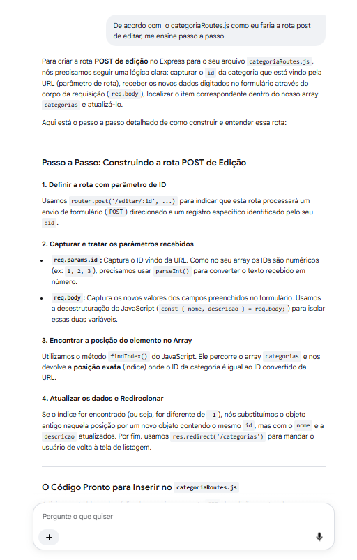

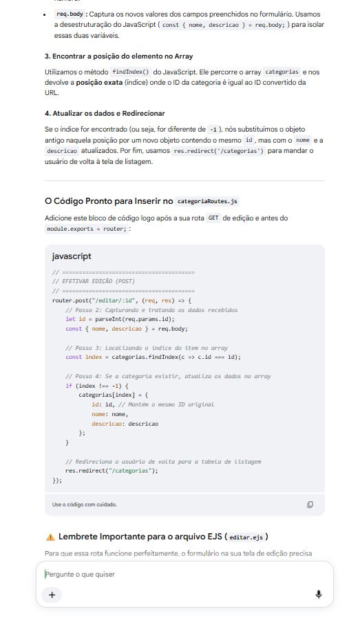

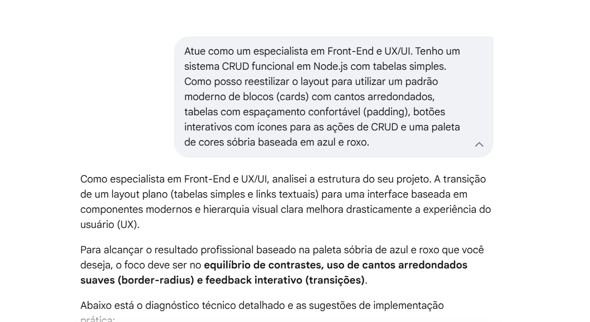

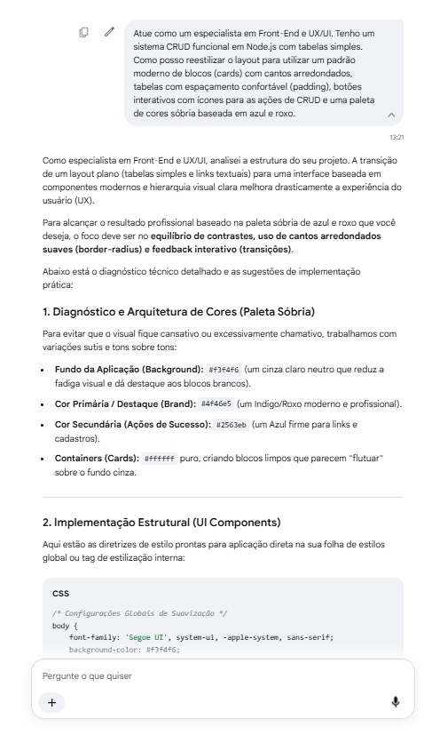

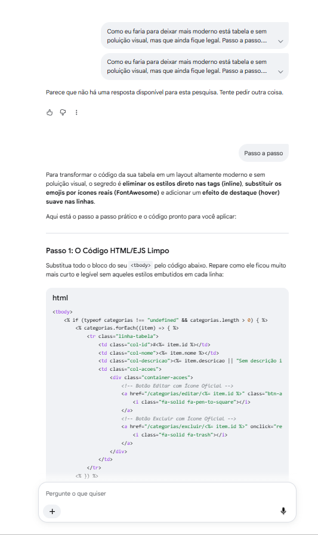

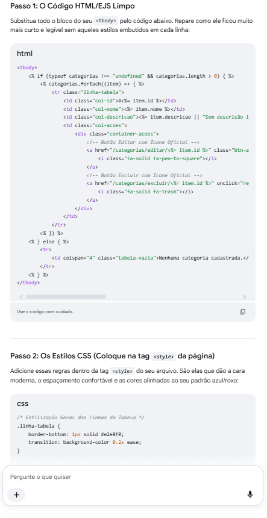

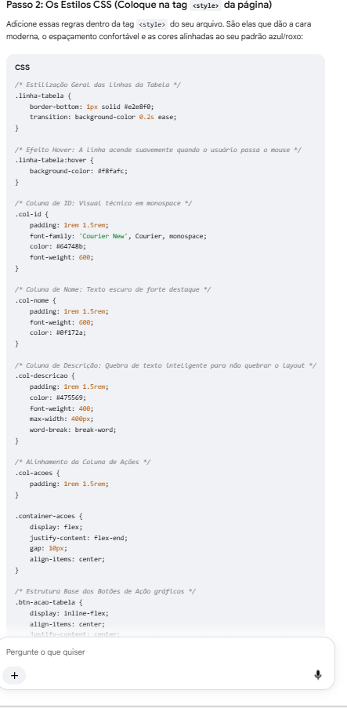

# Antes da Reestilização:

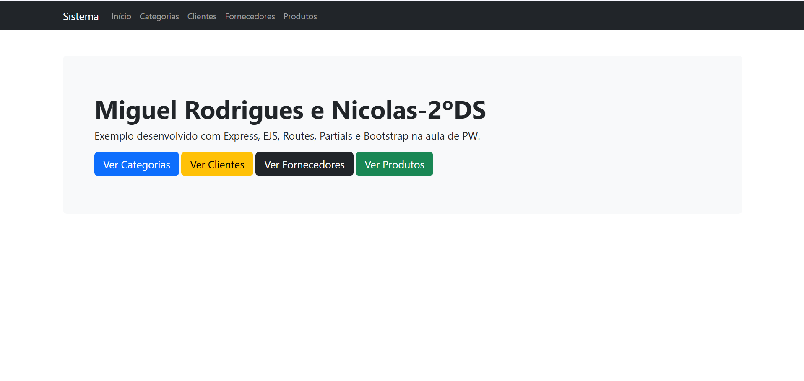

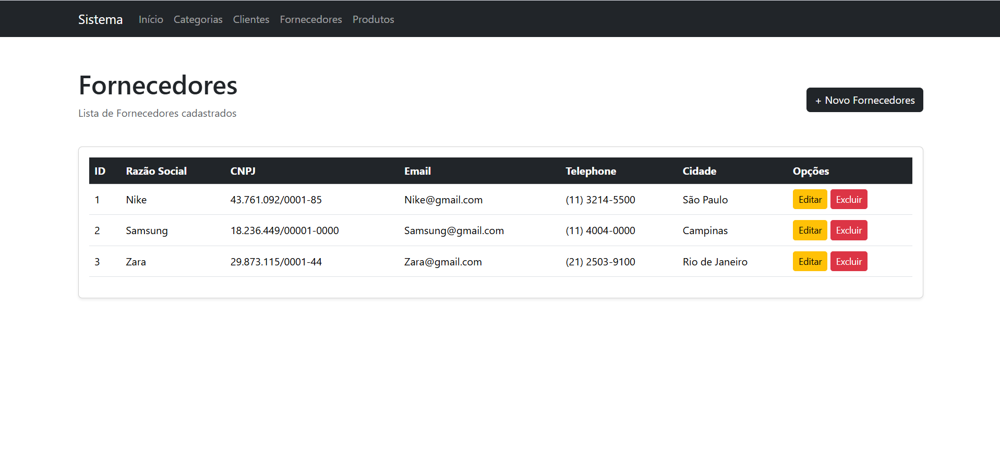

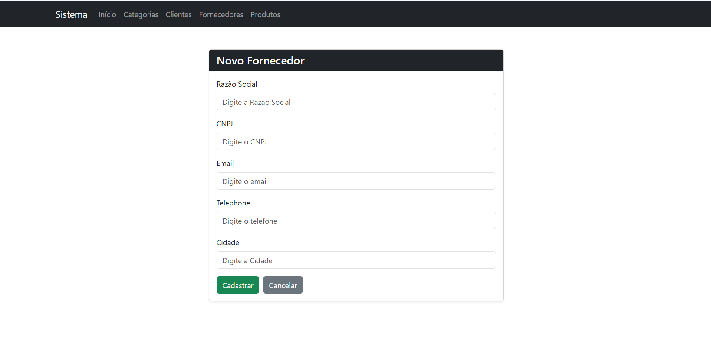

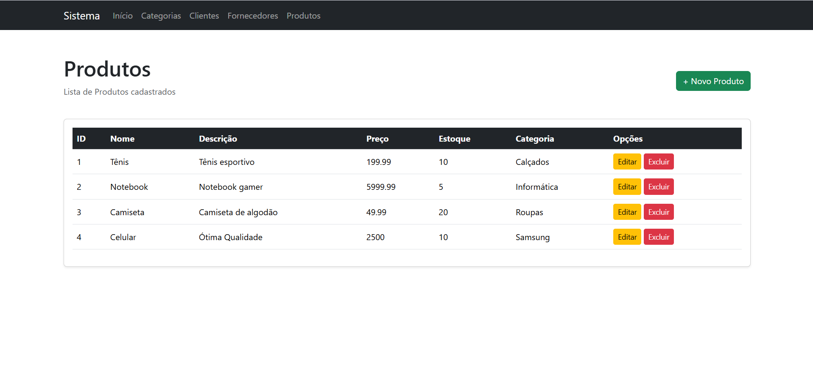

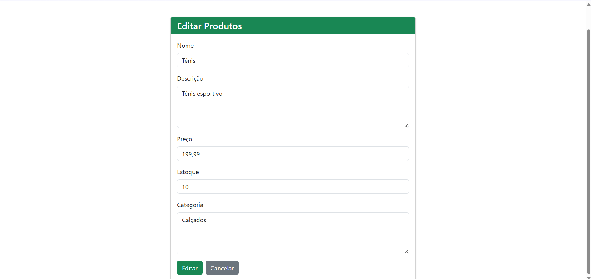

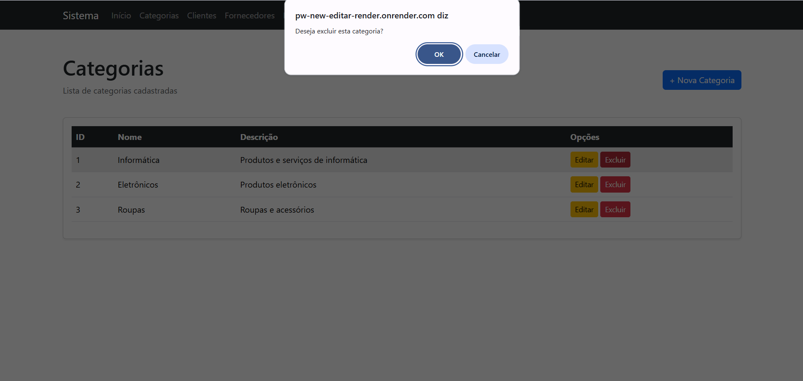

# Depois da Reestilização

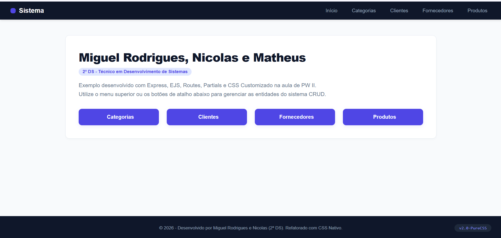

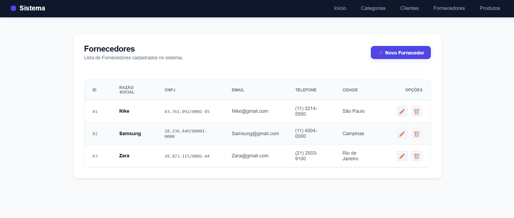

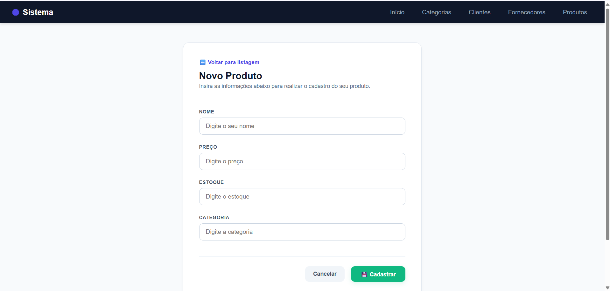

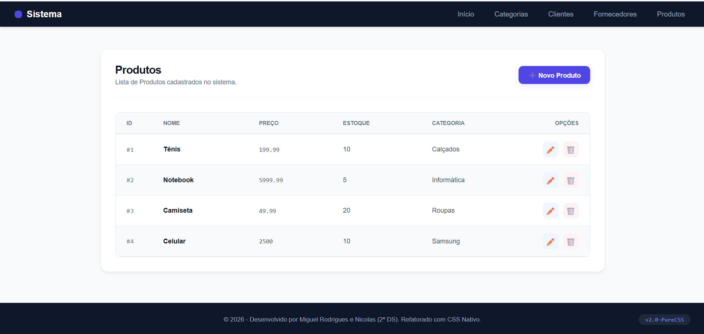

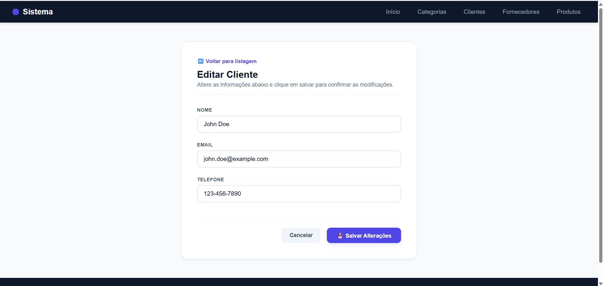

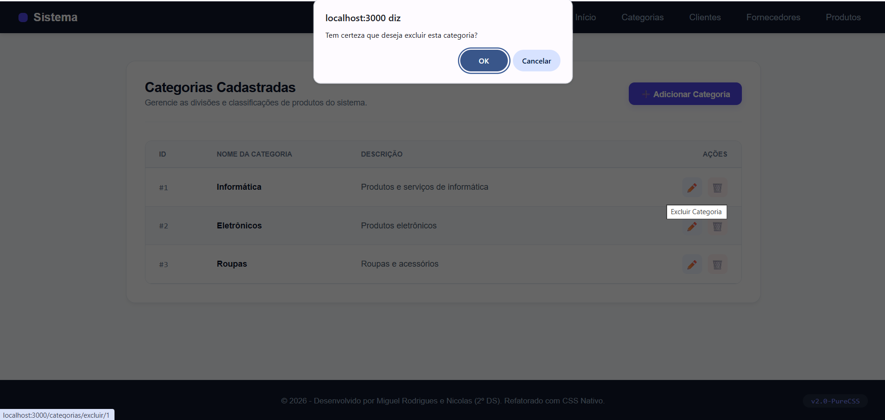

# Links do Projeto:

• Link da Aplicação (Deploy): https://sistema-organiza-o-pw.onrender.com

• Link do Repositório GitHub: https://github.com/miguelrodrigues-dk/Sistema-Organiza-o-PW.git
